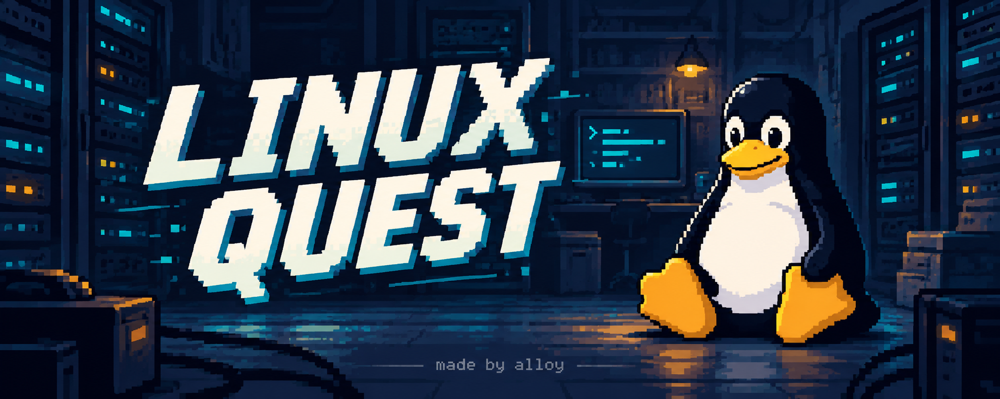
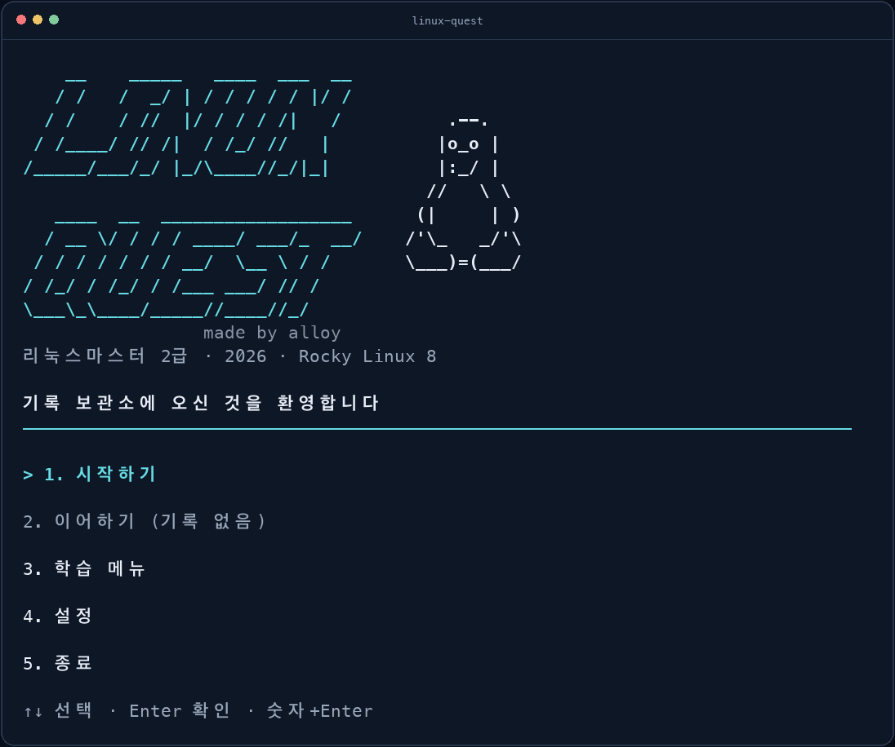
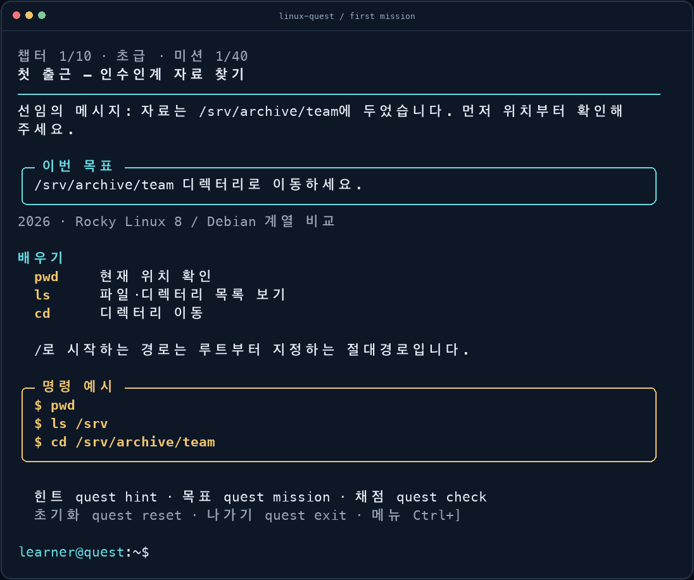
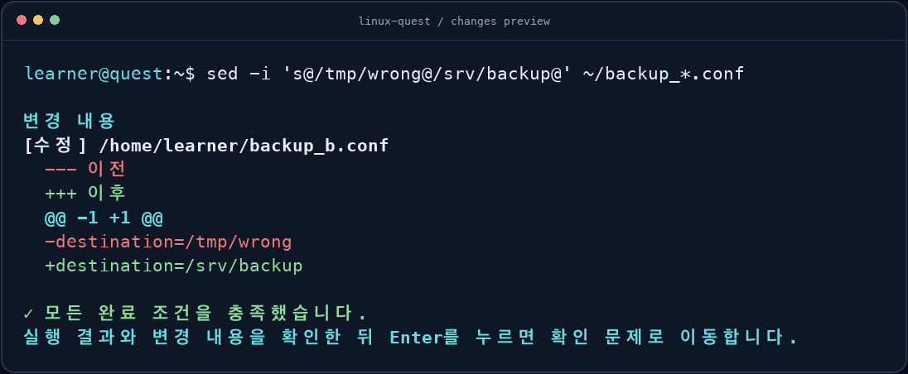

# Linux Quest



[](https://github.com/alloy31/linux-quest/actions/workflows/ci.yml)


**명령어를 직접 쓰면서 배우는 리눅스 실습 게임.**

가상 기록 보관소의 신입 관리자가 되어, 매일 02:00에 실패하는 백업과 사라진 인수인계 기록을 조사합니다.
`cd`로 자료를 찾는 첫 미션부터 권한·프로세스·네트워크를 함께 다루는 종합 미션까지 이어집니다.

[시작하기](#시작하기) · [플레이](#플레이) · [학습 구성](#학습-구성) · [설정과 저장](#설정과-저장)

- **실제 Bash 실습:** Docker 안에서 파일과 권한을 직접 바꾸고, 파이프와 `vi`를 사용합니다.
- **10개 챕터, 40개 미션:** 짧은 의뢰와 단서가 하나의 사건으로 이어집니다.
- **초급·중급·고급:** 설명을 따라 시작하거나, 목표만 보고 해결하거나, 여러 조건을 함께 풀 수 있습니다.
- **복습과 시험 대비:** 단계별 힌트, 오답 복습, 자체 제작 문제 177개와 1·2차 모의시험을 제공합니다.

## 시작하기

**Git**, **Python 3.11 이상**, **실행 중인 Docker**, **macOS 또는 Linux 터미널**이 필요합니다.
게임 실행을 위해 추가로 설치할 Python 패키지는 없습니다. Windows 기본 환경은 지원하지 않습니다.

```bash
git clone https://github.com/alloy31/linux-quest.git
cd linux-quest
python3 install.py
linux-quest
```

`linux-quest`만 실행하면 컬러 화면이 열립니다. 방향키와 Enter, 또는 숫자+Enter로 선택하세요.
설치기는 `~/.local/bin`에 실행 링크를 만듭니다. 명령을 찾을 수 없다면 저장소 안에서 `./linux-quest`로 실행할 수 있습니다.

첫 실습에서는 Rocky Linux 8 이미지와 학습 도구를 내려받습니다. 미리 준비하려면 다음 명령을 실행하세요.

```bash
linux-quest --build-lab
```

준비가 끝나면 실습과 문제 풀이는 외부 인터넷 없이 동작합니다. 네트워크 미션에는 게임 전용 내부망을 사용합니다.

<details>
<summary>시작 화면 보기</summary>



</details>

## 플레이

**설명 읽기 → 직접 실행 → 결과 확인 → 개념 문제 → 다음 미션** 순서로 진행합니다.



첫 미션의 목표는 `/srv/archive/team`으로 이동하는 것입니다.

```bash
pwd
ls /srv
cd /srv/archive/team
```

명령이 끝나면 완료 조건을 자동으로 확인합니다. 같은 결과를 만드는 다른 풀이도 인정합니다.
조건이 남아 있으면 무엇을 더 해결해야 하는지 표시합니다. 편집기 사용 중에는 채점 화면이 끼어들지 않습니다.

`grep` 같은 조회 명령의 출력은 터미널에 남습니다. 파일을 생성·수정·삭제하면 변경 전후를
미리 보여주며, 추가된 줄은 초록색, 삭제된 줄은 빨간색으로 구분합니다. 권한·소유자·환경변수
변경도 확인할 수 있습니다. 미션을 해결해도 **결과를 읽고 Enter를 누른 뒤** 확인 문제로 넘어갑니다.



| 난이도 | 진행 방식 |
| --- | --- |
| 초급 | 필요한 개념과 명령어 예시를 보며 작은 목표부터 해결합니다. |
| 중급 | 목표를 보고 명령어를 조합합니다. 필요하면 힌트를 엽니다. |
| 고급 | 원인을 조사하고 권한·파일·환경 등 여러 조건을 함께 충족합니다. |

일반 학습에는 제한 시간이나 목숨이 없습니다. 모든 난이도에서 힌트를 사용할 수 있고,
해설은 읽은 뒤 Enter로 넘깁니다. 다음 미션과 문제는 새 화면과 번호로 구분합니다.

### 실습 도우미

| 명령 | 기능 |
| --- | --- |
| `quest mission` | 현재 목표 보기 |
| `quest hint` | 개념 → 도구 → 풀이 순서의 3단계 힌트 |
| `quest check` | 바로 채점하고 남은 조건 확인 |
| `quest diff` | 가장 최근에 감지한 변경 다시 보기 |
| `quest answer 값` | 조사한 정보 제출 |
| `quest lesson` | 관련 개념 전체 보기 |
| `quest reset` | 현재 실습을 초기 상태로 다시 시작 |
| `quest skip` | 이번 시도 건너뛰기 |
| `quest exit` | 메인 메뉴로 돌아가기 |
| `Ctrl+]` | 명령 실행 중에도 게임 메뉴 열기 |

`Ctrl+C`는 실행 중인 셸 작업을 중단합니다. 셸이나 Docker 연결이 종료되면 재시도·건너뛰기·메뉴를 선택할 수 있습니다.
파일 변경 미리보기는 실습 작업 경로(`/home/learner`, `/srv/archive`, `/srv/backup`)를 대상으로 합니다.
큰 파일·많은 변경은 표시 범위를 제한하고 생략 여부를 안내합니다.

## 학습 구성

2026년 리눅스마스터 2급 출제기준을 학습 순서로 재구성했습니다.
**35개 개념에 설명과 평가를 연결**하고, 각 챕터 끝에 종합 사건을 배치했습니다.

| 챕터 | 배우는 내용 |
| --- | --- |
| 01. 첫 접속 | 경로·목록·도움말, 리눅스 개요·역사·철학·배포판 |
| 02. 자료실 정리 | 복사·이동·삭제·검색, 하드 링크와 심볼릭 링크 |
| 03. 로그의 단서 | 텍스트 검색·정렬, 표준 입출력·파이프, 압축 |
| 04. 잠긴 보관함 | 사용자·그룹, 권한·소유권·umask |
| 05. 달라진 작업 환경 | 셸·따옴표·변수·환경 설정 |
| 06. 멈추지 않는 작업 | 프로세스·시그널·우선순위·작업 제어·예약 |
| 07. 설정과 도구 | 실제 vi, 로컬 RPM 설치, Debian·소스 설치 비교 |
| 08. 서버 재구성 | 설치·파티션·부팅·저장 공간·장치·인쇄 |
| 09. 연결 복구 | 내부 HTTP 통신, 주소·진단·인터넷 서비스, X 윈도 |
| 10. 최종 점검 | 가상화·클라우드·응용분야, 종합 인계 |

설치·부팅·물리 장치・실제 마운트・GUI는 **모의 상황과 설정 파일 연습**으로 표시합니다.
기본 실습 배포판은 Rocky Linux 8이며, Debian 계열 차이는 설명과 문제로 다룹니다.

### 복습과 모의시험

학습 메뉴에서 힌트를 쓴 미션, 변형 미션, 틀린 문제를 다시 풀 수 있습니다.
기본 완료, 안내 없는 자력 해결, 다음 실행에서의 변형 복습 통과를 구분해 기록합니다.
XP는 미션 최초 완료에만 지급하고, 재도전해도 기존 진도를 지우지 않습니다.

| 모의시험 | 구성 | 합격 기준 |
| --- | --- | --- |
| 1차 | 50문항 · 60분 | 총점 60점 이상 |
| 2차 | 80문항 · 100분 | 총점 60점 이상 + 각 과목 정답률 40% 이상 |

2차는 운영·관리 48문항과 활용 32문항입니다. 답 변경, 이전·다음 이동, 조기 제출,
시간 종료 채점과 해설을 지원합니다. 미응답은 오답으로 계산합니다.
문제는 자체 제작한 학습용 문항이며, 게임 등급과 모의시험 성적은 별도로 표시합니다.

## 설정과 저장

첫 화면의 **설정**에서 바꿀 수 있습니다. 변경하면 바로 적용되고 다음 실행에도 유지됩니다.

| 설정 | 선택 |
| --- | --- |
| 컬러 표시 | 켜기(기본) · 끄기 · 자동 |
| 기본 난이도 | 초급(기본) · 중급 · 고급 |
| 초급 설명 분량 | 간단히(기본) · 자세히 |
| 안내 화면 너비 | 자동(기본) · 최대 60칸 · 최대 100칸 |
| 문제 전환 화면 | 새 화면(기본) · 이전 내용 유지 |

설정과 진도는 `~/.local/share/linux-quest/`에 각각 저장합니다.
`XDG_DATA_HOME`을 설정했다면 해당 경로를 사용합니다. **이어하기는 미완료 미션의 초기 상태**에서 시작하며,
완료·힌트·오답 기록은 유지됩니다. **기본 설정 복원**도 학습 진도는 건드리지 않습니다.

<details>
<summary>실행 옵션과 저장 위치</summary>

```bash
linux-quest --doctor
linux-quest --list
linux-quest --mission 01-arrival --difficulty beginner
linux-quest --exam 1
linux-quest --color never
linux-quest --data-dir /tmp/my-quest-practice
```

`--data-dir`는 설정과 진도를 함께 분리합니다. `--color`와 직접 미션 실행의 `--difficulty`는 이번 실행에만 적용합니다.
저장 파일은 `progress.json`과 `settings.json`이며, 깨진 파일은 자동 덮어쓰지 않습니다.

</details>

## 실행이 잘 안 된다면

| 상황 | 확인할 것 |
| --- | --- |
| `linux-quest` 명령을 찾지 못함 | 저장소에서 `./linux-quest`로 실행하거나 `~/.local/bin`을 PATH에 추가하세요. |
| Docker 연결 오류 | Docker를 실행한 뒤 `linux-quest --doctor`로 확인하세요. |
| 첫 실습 준비가 오래 걸림 | 최초 이미지·패키지 다운로드가 필요합니다. `--build-lab`으로 미리 준비할 수 있습니다. |
| 업데이트 후 이전 화면이 보임 | 메인 메뉴에서 종료하고 다시 실행하세요. |

## 개발과 피드백

호스트의 Python CLI가 화면·학습·채점을, Docker 안의 지속 Bash 세션이 실습을 담당합니다.
개인 폴더·Docker 소켓을 실습에 마운트하지 않고, 호스트 포트를 공개하지 않습니다.

```bash
python3 linux-quest --check-content
PYTHONPATH=src python3 -m unittest discover -s tests -v
```

실제 Docker·터미널 검사 실행법과 검증 범위는 [개발 문서](docs/DEVELOPMENT.md)에 있습니다.
[이미지 제작 기록](docs/assets/README.md)과 [로고 디자인 초안](docs/banner-concepts.md)도 볼 수 있습니다.

오류나 개선 아이디어는 [Issues](https://github.com/alloy31/linux-quest/issues)에 남겨주세요.
사용한 OS·Python·Docker 버전, 실행한 명령과 재현 순서를 함께 적으면 확인에 도움이 됩니다.
이 저장소의 수정은 새 브랜치에서 작업하고, 관련 검사와 CI를 확인한 PR을 머지하는 방식으로 진행합니다.

학습 기준은 [KAIT 시험 안내·출제기준](https://www.ihd.or.kr/introducesubject1.do)입니다.
2027년 이후 시험에는 변경된 출제 환경을 별도로 확인해야 합니다.

## 라이선스

[MIT License](LICENSE)로 공개합니다.

---

made by **alloy**
